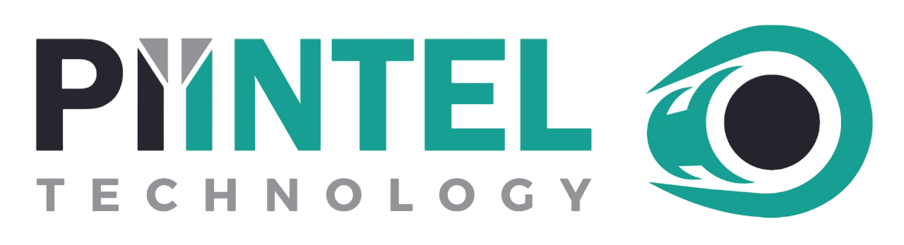

  

# Piintel Technology Sdn. Bhd.

Piintel Technology Sdn. Bhd. offers a comprehensive range of inline pipeline inspection and cleaning services, serving both local and international markets.

## What We Do

### Inspection Services

**Magnetic Flux Leakage (MFL)**
A non-destructive testing method used to detect corrosion, pitting, and other defects in ferromagnetic materials, such as pipelines and storage tanks.

**Multi-Channel Caliper & Foam Caliper**
Capture detailed measurements of a pipeline's internal geometry to identify issues such as dents, ovality, and other mechanical deformations.

### Cleaning Services

We provide pipeline cleaning solutions using foam pigs, brush pigs, and magnetic pigs to remove debris, buildup, and other obstructions from internal pipeline surfaces, helping maintain efficient flow and prevent blockages and corrosion.

### Other Services

We customize tools to meet each client's specific requirements, accommodating a wide range of operating conditions and configurations, including but not limited to:

- High wall-thickness pipelines
- Short launcher/receiver configurations
- Varying pressure conditions (both high and low)
- Long-distance pipelines
